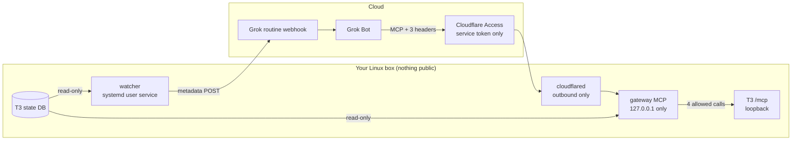

# grok-bot-setup

Connect a cloud assistant ([Grok Bot](https://grok.com)) to things running on your own Linux box, without making that box reachable from the internet.

The first integration is **[T3 Code](https://github.com/pingdotgg/t3code)**. If you run many agent threads and forget to come back to them, this does two things:

- **It tells you when a thread is clearly waiting on you, and only then.** A question that has sat for 10 minutes, or a finished run you still haven't opened after 30. Alerts come in batches, at most one notice and one reminder per thread, with a daily cap. Threads you have already opened, settled, snoozed, or that are subagents never trigger an alert.
- **You can answer from the assistant's chat.** Reply to a finished thread or answer an agent's question, through a 4-tool MCP server that only acts on threads currently waiting on you.

Nothing on your machine listens on a public address. Alerts go out as metadata only (ids, titles, status, times; no message content). The assistant reads a thread's content only when you ask it to.

> Unofficial. Not affiliated with T3 Code or xAI. The watcher reads T3's local database, which is not a public API; see [Compatibility](#compatibility).

## How it works



| Piece | What it does | Can it change anything? |
|---|---|---|
| **watcher** | Polls T3's database read-only every 30 s, applies the alert policy, POSTs a batch to your routine's webhook. | No. It has no listener and no T3 credential. |
| **gateway** | MCP server with `list_waiting`, `read_waiting_thread`, `answer_question`, `reply_to_thread`. | Only answers or replies on threads that are waiting on you, as a new queued turn. It cannot launch threads, approve commands, steer or interrupt, or read other threads. |
| **cloudflared** | Locally configured Cloudflare Tunnel routing one hostname's `/mcp` to the gateway; everything else returns 404. | No. Routing lives in a root-only file on your box, not in the Cloudflare dashboard. |
| **Cloudflare Access** | Blocks every request at Cloudflare's edge unless it carries your one service token. | No. |

Why a separate gateway instead of exposing T3's own `/mcp`: an operate grant on T3's MCP can launch full-access agents, which is a remote shell on your machine. The gateway narrows what the cloud can do to "answer what is waiting on me". Details in [docs/how-it-works.md](docs/how-it-works.md) and [SECURITY.md](SECURITY.md).

## What you get

> **T3: 2 waiting on you**
> - *api · Fix flaky upload test*: asked you a question, waiting 14 min
> - *homelab · Rotate backups*: finished 42 min ago, not opened
>
> Reply here to answer either one.

You: *"tell the backups one: yes, delete the old snapshots"*. The assistant shows the exact text, you confirm, and it lands in the thread as your next message.

## Requirements

- Linux with systemd (user services, plus lingering so they run while you are logged out)
- [Bun](https://bun.sh) 1.2 or newer
- A T3 Code server running locally (tested with `0.1.3-nightly.20261026`)
- For answering from chat: a domain on Cloudflare with Zero Trust enabled (the free plan works). Alerts alone need no Cloudflare.
- A Grok Bot routine with a webhook trigger

## Quick start

The full walkthrough with every command is in **[docs/setup.md](docs/setup.md)**. The short version:

```bash
git clone https://github.com/nsoliven/grok-bot-setup.git && cd grok-bot-setup
bun install
scripts/install.sh install                  # config dir, user services, grok-t3 on your PATH

# 1. Alerts. Save the routine's webhook URL and Authorization value (0600 files):
#      ~/.config/grok-bot-setup/secrets/grok-webhook-url
#      ~/.config/grok-bot-setup/secrets/grok-webhook-authorization
grok-t3 test-webhook
scripts/install.sh install watcher

# 2. Answering from chat
grok-t3 pair                                # the gateway's own T3 credential (30 days)
grok-t3 new-bearer                          # the gateway's bearer token
CLOUDFLARE_API_TOKEN_FILE=~/cf-token bin/grok-t3-cloudflare provision \
  --zone example.com --hostname t3hook-x7k2.example.com --out ~/.config/grok-bot-setup/handoff
scripts/install-tunnel.sh install --tunnel-id <id> --hostname t3hook-x7k2.example.com \
  --credentials ~/.config/grok-bot-setup/handoff/tunnel.json
cat ~/.config/grok-bot-setup/handoff/access.env >> ~/.config/grok-bot-setup/config.env
scripts/install.sh install gateway
```

Then paste the routine prompt from [docs/grok-routine.md](docs/grok-routine.md) and add the MCP connector.

## Day to day

```bash
grok-t3 status          # what is waiting, what was sent, pause and credential state
grok-t3 preview         # the exact webhook body for everything waiting right now
grok-t3 pause 2h        # quiet for a while (answering keeps working)
grok-t3 resume
grok-t3 pair            # renew the gateway's T3 credential (you get an alert 3 days before expiry)
journalctl --user -u grok-t3-watcher -u grok-t3-gateway -f
```

Timing and payload options live in `~/.config/grok-bot-setup/config.env` (documented in [config/config.example.env](config/config.example.env)). Restart the service after editing it.

## Kill switches

| To stop | Do this | Effect |
|---|---|---|
| Alerts for a while | `grok-t3 pause 2h` | The watcher keeps running and sends nothing. |
| Alerts | `systemctl --user disable --now grok-t3-watcher` | Nothing leaves the box. |
| Answering, fastest | T3 → Settings → Sharing & access → revoke **grok-bot-setup gateway** | The gateway can no longer act in T3, even if it were compromised. |
| Answering, keep reading | `GATEWAY_READ_ONLY=1` in config.env, restart the gateway | List and read only. |
| The gateway | `systemctl --user disable --now grok-t3-gateway` | The tunnel has nothing to reach. |
| The internet path | Zero Trust → Access → Service credentials → revoke the token, or `sudo systemctl disable --now cloudflared-grok-t3` | Requests stop at Cloudflare's edge, or the tunnel goes away. |
| Everything | `scripts/install-tunnel.sh uninstall`, `bin/grok-t3-cloudflare teardown`, `scripts/install.sh uninstall --purge` (in that order), then revoke the T3 grant | Services, secrets, tunnel, DNS record and Access app are gone. |
| The assistant side | Disable the routine, or rotate its webhook token | Webhook POSTs are rejected. |

## Repository layout

```
bin/                  grok-t3 (day-to-day CLI), grok-t3-cloudflare (provision / teardown)
config/               config.example.env: every non-secret setting, documented
deploy/systemd/       hardened user units (watcher, gateway) and the cloudflared system unit
deploy/cloudflared/   tunnel config template: one hostname, /mcp only, 404 for everything else
docs/                 setup walkthrough, how it works, the Grok routine prompt
scripts/              install.sh, install-tunnel.sh, check-secrets.sh
src/t3/               state reader, alert policy, webhook payload, watcher, gateway, pairing
src/cloudflare/       Cloudflare API provisioning and teardown
test/                 alert policy, state rules, gateway auth and refusals
```

## Compatibility

T3 has no public API for "have I opened this thread", so the watcher reads T3's own SQLite projections read-only and mirrors T3's own awareness rules. It checks the columns it needs whenever it opens the database; if a T3 update changes them, you get one `t3.watcher_problem` alert instead of silence. Answering goes through T3's official MCP tools: `t3_thread_send`, and `t3_pending_request_read`/`_respond`, or their merged form `t3_pending_request` in T3 nightlies after 2026-10-26. The gateway asks T3 which one it has.

Approvals ("Allow running this command?") cannot be granted over T3's MCP at all, so those alerts tell you to open T3.

### Why not connect Grok to T3's own MCP?

T3 supports outside agents directly: turn on T3 Connect, give a hosted assistant the environment's `/mcp` URL, and sign in with OAuth (see T3's `docs/user/outside-agents.md`). Since late October 2026, linked environments let that one connection reach your other machines too. If you want to launch and steer any thread on any machine from chat, use that.

This project exists for a narrower job:

- **Alerts only when you're clearly forgetting.** T3's push notifications fire on every finish, failure, question and approval. The watcher waits, batches, caps and reminds once.
- **A smaller surface.** T3's MCP gives the assistant every thread, project and setting the grant allows, and T3 Connect makes the whole T3 server reachable through T3's relay. The gateway exposes four tools, only for threads that are waiting on you, behind Cloudflare Access on a single path.

## Development

```bash
bun test
bunx tsc --noEmit -p .
scripts/check-secrets.sh    # gitleaks plus your private word list; run before every push
```

Thanks to [T3 Tots](https://github.com/Deepusleepy/t3-tots) for showing what a T3 companion for Grok Bot can look like.

## License

[MIT](LICENSE)
