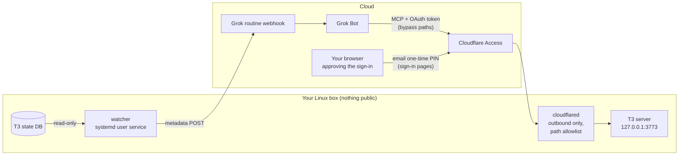

# grok-bot-setup

Connect a cloud assistant ([Grok Bot](https://grok.com)) to things running on your own Linux box, with the smallest exposure you can get.

The first integration is **[T3 Code](https://github.com/pingdotgg/t3code)**. If you run many agent threads and forget to come back to them, this does two things:

- **It tells you when a thread is clearly waiting on you, and only then.** A question that has sat for 10 minutes, or a finished run you still haven't opened after 30. Alerts come in batches, at most one notice and one reminder per thread, with a daily cap. Threads you have already opened, settled or snoozed never trigger an alert, and neither do subagent threads.
- **You can answer from the assistant's chat.** The assistant signs in to T3's own MCP server, the same way T3's docs describe for hosted agents. The difference: it gets there through your own Cloudflare Tunnel instead of T3 Connect, and the tunnel only lets through the sign-in and MCP paths.

Nothing on your machine listens on a public address. Alerts go out as metadata only (ids, titles, status, times; no message content). The assistant reads a thread's content only when it calls T3.

> Unofficial. Not affiliated with T3 Code or xAI. The watcher reads T3's local database, which is not a public API; see [Compatibility](#compatibility).

## How it works



| Piece | What it does | Can it change anything? |
|---|---|---|
| **watcher** | Polls T3's database read-only every 30 s, applies the alert policy, POSTs a batch to your routine's webhook. | No. It has no listener and no T3 credential. |
| **T3's MCP** | T3's own `/mcp`, with T3's own OAuth sign-in. You approve the assistant once with a pairing code and pick its access level. | Whatever you allow at approval, up to full access. See [SECURITY.md](SECURITY.md). |
| **cloudflared** | A locally configured Cloudflare Tunnel. For one hostname it forwards only T3's MCP sign-in and `/mcp` paths; T3's app, API and websocket return 404. | No. Routing lives in a root-only file on your box, not in the Cloudflare dashboard. |
| **Cloudflare Access** | Every page on the hostname needs a one-time PIN sent to your email. Only the six paths the assistant's servers call skip it; T3's OAuth protects those. | No. |

### Why Cloudflare and not T3 Connect

T3 Connect works too: it makes the whole T3 server reachable through T3's relay, protected by T3's sign-in. This setup puts the same sign-in behind your own domain with two more layers: a tunnel that exposes only the sign-in and MCP paths, and an Access login on the pages your browser uses. Nobody but you can even load the approval page.

## What you get

> **T3: 2 waiting on you**
> - *api · Fix flaky upload test*: asked you a question, waiting 14 min
> - *homelab · Rotate backups*: finished 42 min ago, not opened
>
> Reply here to answer either one.

You: *"tell the backups one: yes, delete the old snapshots"*. The assistant shows the exact text, you confirm, and it lands in the thread as your next message.

## Requirements

- Linux with systemd (user services, plus lingering so they run while you are logged out)
- [Bun](https://bun.sh) 1.2 or newer
- A T3 Code server listening on loopback (tested with `0.1.3-nightly.20261026`)
- For answering from chat: a domain on Cloudflare with Zero Trust enabled (the free plan works). Alerts alone need no Cloudflare.
- A Grok Bot routine with a webhook trigger, and an MCP connector with OAuth

## Quick start

The full walkthrough with every command is in **[docs/setup.md](docs/setup.md)**. The short version:

```bash
git clone https://github.com/nsoliven/grok-bot-setup.git && cd grok-bot-setup
bun install
scripts/install.sh install                  # config dir, watcher service, grok-t3 on your PATH

# 1. Alerts. Save the routine's webhook URL and Authorization value (0600 files):
#      ~/.config/grok-bot-setup/secrets/grok-webhook-url
#      ~/.config/grok-bot-setup/secrets/grok-webhook-authorization
grok-t3 test-webhook
scripts/install.sh install

# 2. Answering from chat
CLOUDFLARE_API_TOKEN_FILE=~/cf-token bin/grok-t3-cloudflare provision \
  --zone example.com --hostname t3-x7k2.example.com --allow-email you@example.com \
  --out ~/.config/grok-bot-setup/handoff
scripts/install-tunnel.sh install --tunnel-id <id> --hostname t3-x7k2.example.com \
  --credentials ~/.config/grok-bot-setup/handoff/tunnel.json
shred -u ~/.config/grok-bot-setup/handoff/tunnel.json
```

Then add the MCP connector (`https://t3-x7k2.example.com/mcp`, OAuth) and the prompts from [docs/grok-routine.md](docs/grok-routine.md), and approve the sign-in.

## Day to day

```bash
grok-t3 status          # what is waiting, what was sent, whether alerts are paused
grok-t3 preview         # the exact webhook body for everything waiting right now
grok-t3 pause 2h        # quiet for a while (answering keeps working)
grok-t3 resume
journalctl --user -u grok-t3-watcher -f
```

The assistant's T3 sign-in lasts 30 days. After that it asks you to approve again, the same way as the first time.

Timing and payload options live in `~/.config/grok-bot-setup/config.env` (documented in [config/config.example.env](config/config.example.env)). Restart the watcher after editing it.

## Kill switches

| To stop | Do this | Effect |
|---|---|---|
| Alerts for a while | `grok-t3 pause 2h` | The watcher keeps running and sends nothing. |
| Alerts | `systemctl --user disable --now grok-t3-watcher` | Nothing leaves the box. |
| Answering, fastest | T3 → Settings → Sharing & access → revoke the assistant's client | Its token stops working immediately. |
| The internet path | `sudo systemctl disable --now cloudflared-grok-t3` | The hostname has nothing behind it. |
| Everything | `scripts/install-tunnel.sh uninstall`, `bin/grok-t3-cloudflare teardown`, `scripts/install.sh uninstall --purge` (in that order), then revoke the assistant in T3 | Services, secrets, tunnel, DNS record and Access apps are gone. |
| The assistant side | Disable the routine, remove the connector, or rotate the webhook token | Webhook POSTs are rejected; the assistant has no T3 tools. |

## Repository layout

```
bin/                  grok-t3 (day-to-day CLI), grok-t3-cloudflare (provision / teardown)
config/               config.example.env: every non-secret setting, documented
deploy/systemd/       hardened watcher user unit and the cloudflared system unit
deploy/cloudflared/   tunnel config template: one hostname, a path allowlist, 404 for everything else
docs/                 setup walkthrough, how it works, the Grok routine prompt
scripts/              install.sh, install-tunnel.sh, check-secrets.sh
src/t3/               state reader, alert policy, webhook payload, watcher
src/cloudflare/       Cloudflare API provisioning and teardown
test/                 alert policy, state rules, tunnel path allowlist
```

## Compatibility

T3 has no public API for "have I opened this thread", so the watcher reads T3's own SQLite projections read-only and mirrors T3's own awareness rules. It checks the columns it needs whenever it opens the database; if a T3 update changes them, you get one `t3.watcher_problem` alert instead of silence.

The tunnel's path allowlist matches the paths T3's MCP sign-in used in `0.1.3-nightly.20261026`. If a T3 update moves its approval page, the sign-in fails closed (404) until [`deploy/cloudflared/config.example.yml`](deploy/cloudflared/config.example.yml) is updated.

Approvals ("Allow running this command?") cannot be granted over T3's MCP at all, so those alerts tell you to open T3.

## Development

```bash
bun test
bunx tsc --noEmit -p .
scripts/check-secrets.sh    # gitleaks plus your private word list; run before every push
```

Thanks to [T3 Tots](https://github.com/Deepusleepy/t3-tots) for showing what a T3 companion for Grok Bot can look like.

## License

[MIT](LICENSE)
